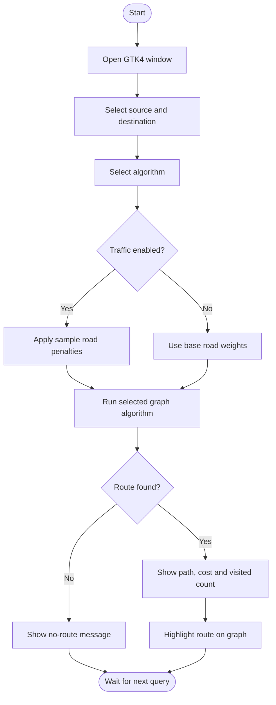
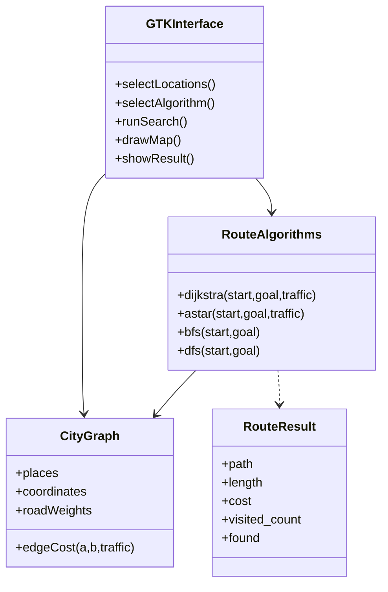

# Editable diagrams

These Mermaid diagrams can be pasted into a Mermaid-compatible editor (for example, Mermaid Live Editor) and exported for the report.

## System flow

## High-level class/module view

